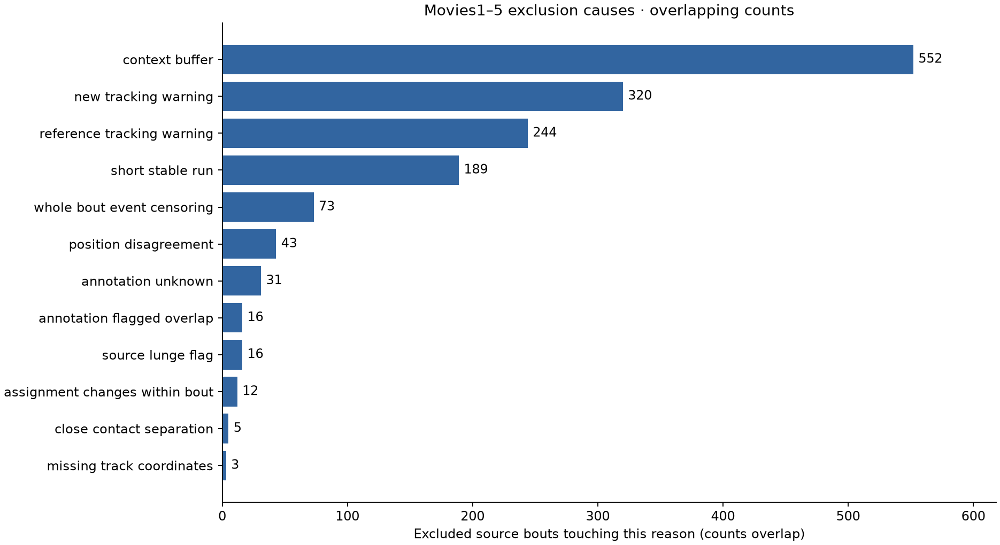
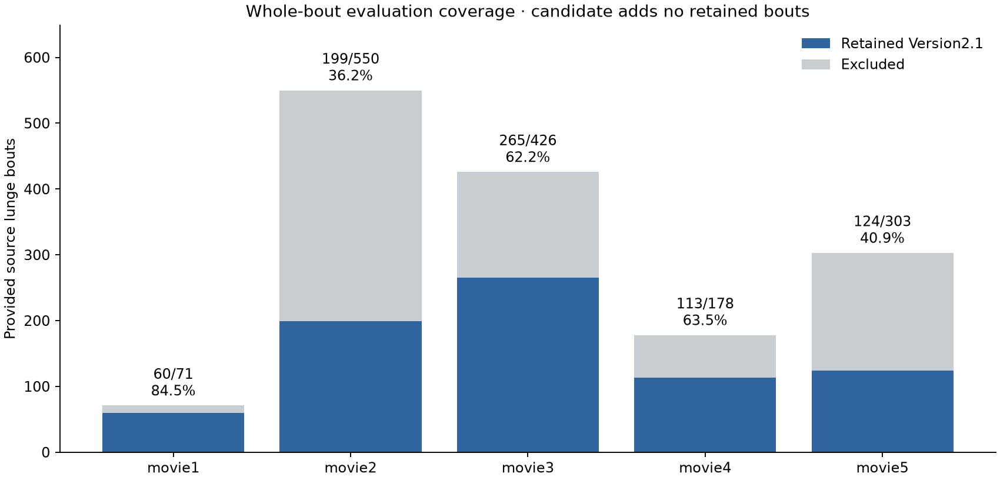
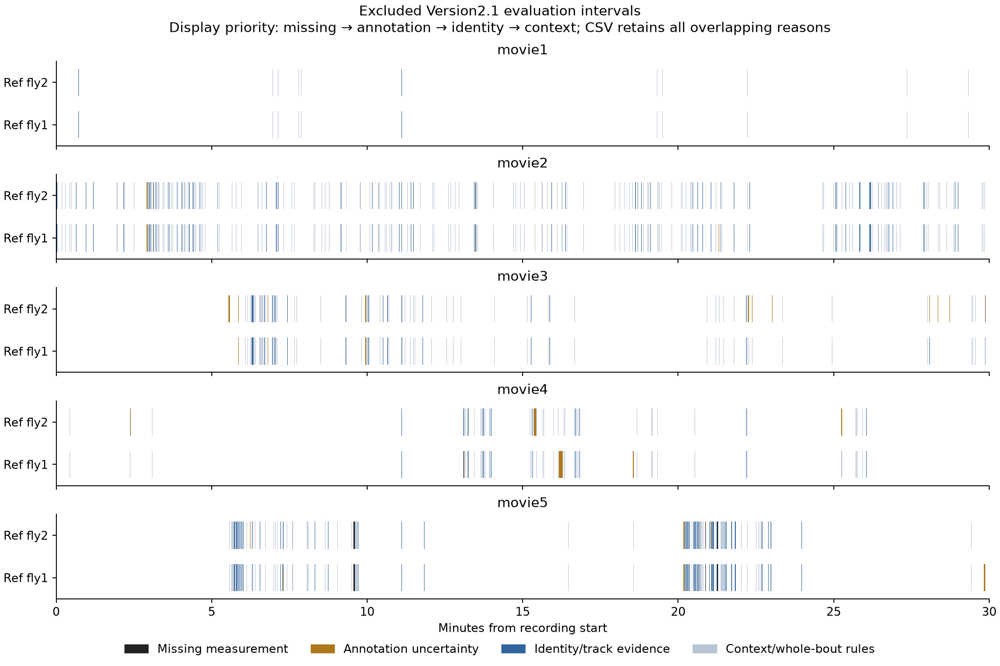

# FlyAggression Analyzer 2.2 — Days 1–2

21 October 2026 · PRJ 501 · Development audit and reference-assisted identity alignment

The exclusion audit is complete for movies 1–5. A conservative identity-alignment module is implemented and tested. **No additional real-data corrections met the evidence rules, and event coverage did not increase.** Version 2.1 remains the working application; this delivery is an offline development tool, not a new runtime classifier or an accuracy improvement.

## Day 1: exclusion audit

The audit reconstructed Version 2.1 correspondence, reliability masks, whole-bout eligibility and final event coverage from source data. Pointwise mapping and evaluation masks were checked against the saved Version 2.1 artifacts. Every excluded source bout has a documented category.

| Recording | Source expert bouts | Retained | Excluded |
|---|---:|---:|---:|
| movie1 | 71 | 60 | 11 |
| movie2 | 550 | 199 | 351 |
| movie3 | 426 | 265 | 161 |
| movie4 | 178 | 113 | 65 |
| movie5 | 303 | 124 | 179 |
| Total | 1,528 | 761 | 767 |

Movie 5 retains 40.92% of source bouts, unchanged from Version 2.1. These are annotation-coverage counts, not detection-performance scores.

Among excluded bouts, 552 touch context buffers, 320 touch new-tracker warnings, 244 touch reference-tracker warnings, and 189 touch short stable runs. These categories overlap and must not be added. Only five touch the close-contact separation gate itself. Warning intervals indicate tracking ambiguity; they do not establish a confirmed biological identity swap.



Twelve bouts had a legacy `features_finite=False` flag despite finite mapped feature measurements. Their source-track assignment changed within the bout. The audit separates this assignment failure from genuine nonfinite measurements; historical Version 2.1 files were preserved.



The largest 60-second losses are movie5/reference fly1 at 1260–1320 seconds (32 bouts), movie3/reference fly1 at 360–420 seconds (31), and movie2/reference fly1 at 240–300 seconds (30). These are useful priorities for manual review. Each bout is assigned once by its start frame. Summed bout durations in the CSV are not unique frame occupancy.



Detailed outputs include bout-level causes, exclusive primary causes, per-recording/per-reference-fly coverage, exact excluded intervals and worst time windows. Primary causes use the fixed order in `reason-order.json`; they reconcile to 767. Overlap columns retain all applicable causes. Most `reason_frames_*` fields count affected frames; bout-level assignment-change, source-flag and overlap-closure fields count the whole affected bout's exposure, not individual switch instants.

## Day 2: conservative identity correspondence

The new module compares position, axial orientation and movement against reference trajectories. It can bridge a short uncertain interval only with reliable evidence on both sides, tight position and movement agreement, and an unambiguous orientation assignment. It never overrides native/reference warning intervals, fills missing measurements or chains newly accepted bridges into its own evidence.

Predeclared limits: gap at most 12 frames; 15 reliable anchor frames per side; pair error at most 3 pixels; separation at least 4 pixels; axial orientation error at most 30 degrees and alternative-assignment disadvantage at least 45 degrees; aligned movement residual at most 2 pixels/frame; at most one assignment change across the bridge and anchors. These are development heuristics, not certified identity probabilities. They were not tuned against detection F1.

| Recording | Reliable frames before / after | Remaining uncertain frames | Accepted new bridges |
|---|---:|---:|---:|
| movie1 | 53,427 / 53,427 | 573 | 0 |
| movie2 | 48,172 / 48,172 | 5,828 | 0 |
| movie3 | 51,739 / 51,739 | 2,261 | 0 |
| movie4 | 52,653 / 52,653 | 1,347 | 0 |
| movie5 | 50,354 / 50,354 | 3,646 | 0 |

All recordings contain 54,000 frames. Rejections primarily reflect long gaps, tracking warnings or inadequate reliable anchors. Zero corrections is the supported outcome; uncertain identities remain flagged.

Switch diagnostics include trajectory-window CSVs, five-frame contact sheets and four-second clips for one selected case per recording. Reference-correspondence changes and pairing flicker are diagnostic categories, not verified biological switches. Axial orientation has a 180-degree ambiguity. Visual examples help review continuity but do not constitute new expert behavioural annotations.

Derived reference-aligned track views retain exact raw source measurements on reliable frames. Uncertain rows have missing measurements, source ID 0 and an explicit reliability flag. Original tracking arrays remain untouched. This procedure requires reference tracks; it is not an autonomous identity correction system for arbitrary uploads.

## Verification and reproducibility

- Seven focused identity tests cover a supported persistent switch, ambiguous orientation, warning protection, excessive gaps, excessive movement residual, missing orientation and unchanged inputs.
- The independent verifier reconciles source-bout counts and causes, compares derived measurements to raw arrays, and verifies preserved Version 2.1 files and external release/launcher hashes. See `reports/v22-days1-2/verification.json` and test logs for final results.
- Configuration is saved in `config/v22-days1-2.json`; preservation hashes in `config/v22-preservation.json`; derived parquet hashes in `reports/v22-days1-2/derived-data-manifest.json`.
- Development branch: `v2.2`, based on Version 2.1 commit `1455986`. Source datasets are read from the existing Version 2.1 data directory and original annotation collection. Derived data are local ignored files under `data/v22-derived/`; no input symlinks or rewrites were used.

Run from this worktree using the existing environment:

```sh
../drosophila-aggression/.venv/bin/python scripts/v22/audit_exclusions.py
../drosophila-aggression/.venv/bin/python scripts/v22/review_switches.py
../drosophila-aggression/.venv/bin/python scripts/v22/figures.py
../drosophila-aggression/.venv/bin/python scripts/v22/verify.py
../drosophila-aggression/.venv/bin/python -m unittest discover -s tests/v22 -v
```

## Limits and next work

Day 1's audit deliverable and Day 2's alignment-module deliverable are complete. Day 2's desired reduction in demonstrated identity mismatches has **not** been achieved on these recordings. The next step is targeted expert review of warning-heavy intervals and original annotation correspondence, retaining uncertainty until sufficient evidence supports correction.

No classifier was retrained, no event thresholds were optimized, and no new accuracy metrics or independent-validation claims are made. Movies 1–5 are development data; previously examined movies 6–10 do not constitute an untouched final test set. Physical arena diameters were not newly verified in this phase. The existing Version 2.1 model, original model, app and Desktop launch shortcut remain unchanged.
