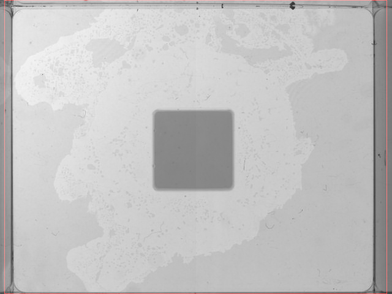
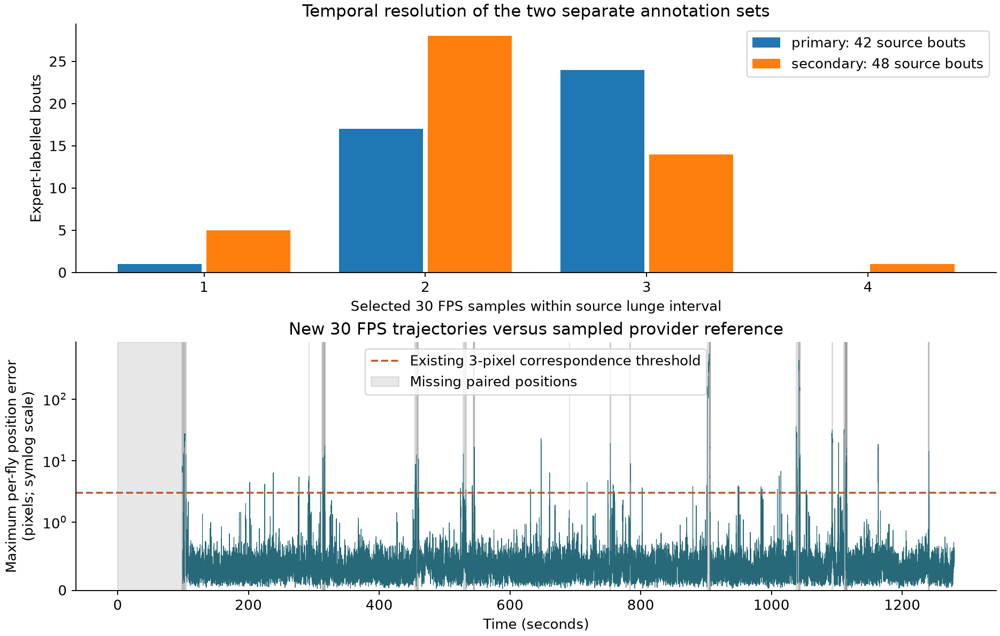
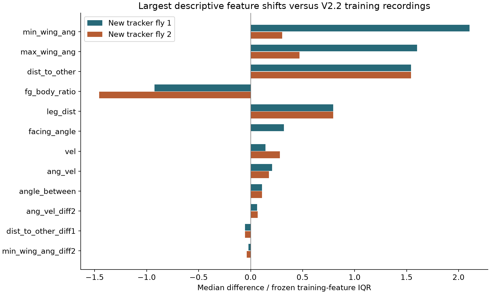

# FlyAggression Analyzer 2.3 — Days 1–4

Completed on 2026-10-24 in the separate `v2.3` worktree, based on frozen 2.2 commit `5f3deaf`. This delivery covers dataset inspection, video/time import, rectangular calibration, full-recording tracking and 36-feature extraction. It does **not** report classifier accuracy: no aggression-model inference, fitting, threshold changes or event scoring was performed.

## Day 1 — Dataset verified and documented

Provider: [Caltech Fly-vs-Fly dataset](https://data.caltech.edu/records/zrznw-w7386), DOI 10.22002/D1.1893, provider CC0 record. The downloaded BoyMeetsBoy archive contains annotations, reference tracks and already augmented features for six recordings; only movie 5's raw video is downloaded. Movie 5 was selected after inspecting lunge counts, not through random independent cohort selection. It has not influenced model training or prediction selection. Its namespace is `flyvsfly_boymeetsboy_movie5`, distinct from Aggression/movie 5 used for development.

The original MJPEG AVI is 640×480,200 FPS,255929 frames,1279.645 seconds. Provider MD5s and local SHA256s match the downloaded files; extracted archive contents were verified against ZIP bytes/CRC. `dataset-inventory.json` records every available MAT's keys, shapes and hashes. Reference tracks have 2×255929×17 measurements; current FlyTracker emits 35 tracking measurements with a different column order. Coordinates are compared by names, not positional assumptions.

Primary expert annotations contain 42 lunges (fly 1:1, fly 2:41); the second annotator contains 48 (fly 1:2, fly 2:46). They remain separate, not 90 distinct ground-truth events or a consensus. Provider viewer start:end indexing confirms 1-based inclusive source-frame bounds. Biological onset/offset criteria, extra annotation-column semantics, exhaustive negatives and biological fly-identity continuity remain unverified. Extra columns are retained verbatim. No missing video files are represented as available.

## Day 2 — Full import and timestamp mapping

The complete original AVI decoded all 255929 frames with error-abort enabled and no reported errors. All 38390 actual decoded analysis timestamps are strictly increasing and match the 30 FPS grid within 0.34 microseconds in FFprobe printed precision (`full-video-verification.json`). The complete deterministic 30 FPS stream contains 38390 frames at the original resolution. All 38390 decoded YUV frame hashes match the selected source frames. No spatial resize, frame interpolation or lossy quantization was introduced. MATLAB's actual RGB reader differed by at most 1 intensity level on nine paired frames spanning the recording; exact YUV parity therefore does not imply identical RGB arrays across decoder paths.

`frame-time-map.csv` retains every source index and both timestamps. Analysis frame k, zero-based, selects `min(round(k*200/30),255928)` with integer half-up rounding. Maximum sample-time jitter is 1.667 ms, with no accumulated drift. The final analysis-grid duration is 21.667 ms longer than source duration, less than one 30 FPS period; the last selected native frame is 255928. Event endpoints are quantized separately: maximum observed absolute onset/stop shift is 30 ms, **not**1.67 ms.

All 42 primary and 48 secondary lunges retain at least one sample under the predetermined phase. However 18/42 primary and 33/48 secondary bouts retain only one or two samples. The frozen event detector requires at least 3 frames after its unchanged smoothing/merging rules, so event loss remains a material risk; retaining one sample is not successful event detection. No threshold or sampling phase was tuned to annotations.

A native 200 FPS 400-frame clip at 640 seconds completed tracking and 13-feature extraction using the full-recording background/body calibration. Standalone 2-second automatic calibration failed its two-fly reliability check and is documented in retained logs; full native 200 FPS tracking was not run. The native velocity kernel has 9 samples versus 3 at 30 FPS. Provider 200 FPS 36-feature MATs cannot be assumed interchangeable with 30 FPS model inputs: five-sample derivative endpoints span 20 ms versus 133.33 ms. We regenerate features from 30 FPS trajectories instead.

An additional FFmpeg fixture exposed an extra clipped-tail frame for some shorter source lengths. The selector now rejects rounded output indices beyond the intended count; regression fixtures 7,8,13,31,40 frames pass. Both old and guarded selectors select exactly the same 38390 indices for this full recording, whose verified conversion remains preserved. An initial FFmpeg rate-mode configuration error and dependency-path error were also corrected; failed attempts remain in logs.

## Day 3 — Rectangular calibration

Configurable inclusive bounds[20,10,620,479], padded 12 pixels and clipped to[8,1,632,480], replace circular assumptions for this offline import. The calibrated ROI uses correct row/column dimensions 480×640. The pinned FlyTracker body/contrast refinement passed on the full recording; parameters are in `calibration.json`. The existing circular code was not edited.

The [published assay description](https://projet.liris.cnrs.fr/imagine/pub/proceedings/ECCV-2014/papers/8690/86900772.pdf) supplies nominal 4×5 cm and 12 pixels/mm. No per-record measurement certificate was available. The padded mask is a tracking region, not a measured physical wall. All 489,381 finite reference centroids lie inside it;22,477 reference fly/frame positions are nonfinite. Centroid containment does not prove entire fly bodies are retained: bodies near image boundaries may be clipped. Raw wall distance is excluded from the 36-feature schema.

## Day 4 — Full tracking, extraction and compatibility audit

Full 30 FPS tracking completed for both output streams across 38390 frames, with missing positions and features retained rather than silently removed. Raw feature shape is 2×38390×13; converted shape is 2×38390×36 with the frozen bundle's exact names/order. New `features36.mat` carries the adapter provenance marker; a regression test confirms original-feature mode rejects it before classifier invocation. The original workflow and models remain unchanged.

| New fly | Missing XY frames | Longest XY gap (frames) | Nonfinite 36-feature rows |
|---|---:|---:|---:|
| 1 | 216 | 31 | 2634 |
| 2 | 3258 | 2631 | 2669 |

The longest new fly 2 position gap covers 0–87.7 seconds; the sampled reference also lacks one fly position throughout that same interval. It is not valid two-fly tracking evidence, and its presence in both outputs does not establish a newly introduced tracking failure. Elsewhere 43 new fly 1 missing frames and 147 new fly 2 missing frames occur when both reference positions are finite. `missing-data-intervals.csv` records every gap. The zero-offset trajectory comparison has the lowest median pair error among offsets−3 through+3; no automatic frame shift was applied.

The pinned extractor interpolates internal tracking gaps before feature computation. Finite features can therefore conceal invalid original tracking; missingness and flags must remain part of future eligibility rules. No imputer/scaler was fitted on this dataset. Whole-recording per-fly median normalization and the original log/five-sample transforms were retained, including their offline dependence on the complete recording.

The conservative existing geometric rules find 33,704/38,390 frames (87.79%) with stable correspondence to sampled reference positions. They use 3 pixels maximum error,4 pixels assignment margin,8 pixels separation,15 stable frames and 5 frame boundary exclusion. This is relative geometric correspondence, not expert-certified biological identity. The diagnostic marks 38 new tracking-warning frames and 7 reference-warning time bins. No identities were forcibly reassigned. Best-assignment changes are diagnostic, not a certified count of identity swaps. The full timeline and intervals remain inspectable in CSVs.

Training-reference comparison uses only the frozen 2.2 training-recording features. It reports descriptive per-fly quantiles, median differences scaled by training IQR and fractions outside training 1 st–99 th percentiles. It does not fit a classifier or claim distribution equivalence. Largest observed shifts:

| Feature | New fly | Median shift / training IQR | Outside training 1 st–99 th percentiles |
|---|---:|---:|---:|
| min_wing_ang | 1 | 2.10 | 2.9% |
| max_wing_ang | 1 | 1.60 | 1.3% |
| dist_to_other | 1 | 1.54 | 45.6% |
| dist_to_other | 2 | 1.54 | 45.6% |
| fg_body_ratio | 2 | -1.46 | 70.1% |

Names, ordering and units are technically compatible; physical scale uncertainty, tracking/identity reliability, short-event sampling, decoder rounding and cross-dataset feature shifts remain scientific compatibility issues. Current evidence supports producing and auditing inputs; it does not establish generalization or expert-equivalent aggression measurement. Future evaluation needs locked annotation/identity/coverage rules before model predictions are examined.

## Preservation and verification

585 frozen 2.2 tracked files,3 external release/launcher artifacts,9 original frozen-bundle files,6 original extractor sources and 209 pinned dependency files passed hash checks. The 2.2 worktree remains clean. All 2.3 changes are additive; inherited app/model/event-rule files are unchanged. Ten new unit/integration tests, six inherited alignment tests, six MATLAB invalid-geometry cases and the saved positive mask/ROI checks passed. Read-only review identified the MAT provenance issue; it was fixed and tested. Logs preserve corrected import failures instead of treating them as successful runs.

## Reproduce and inspect

See [REPRODUCE-V23-DAYS1-4.md](REPRODUCE-V23-DAYS1-4.md), `config/v23-import.json`, `config/v23-dependencies.json` and the `reports/v23-days1-4/` receipts. Large video/tracking/feature files remain in ignored local `data/` with recorded hashes. This is an offline Days 1–4 delivery, not a new Streamlit release, final model evaluation or accuracy improvement.
