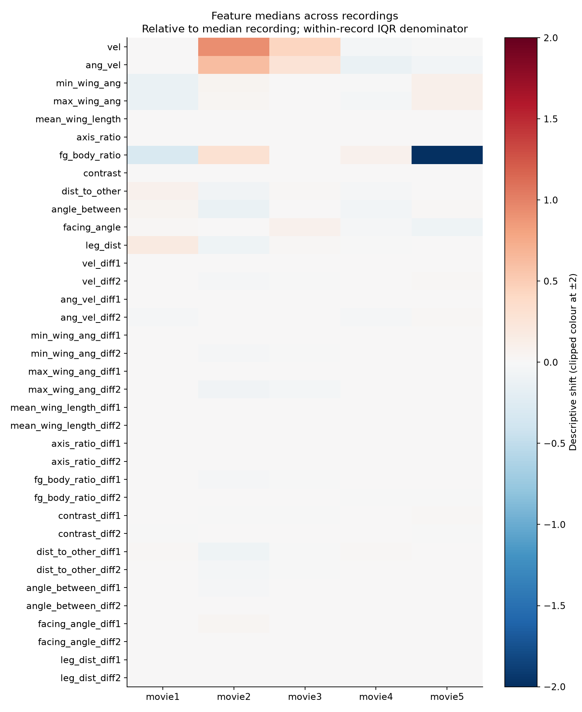
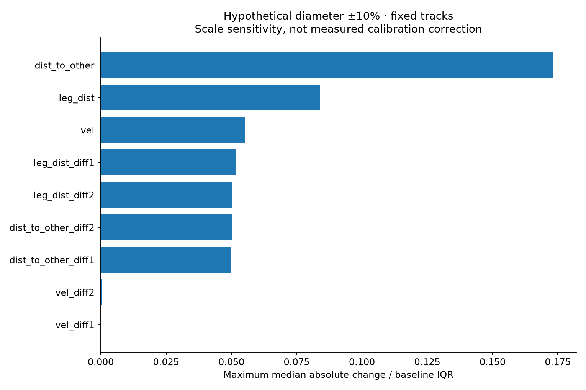
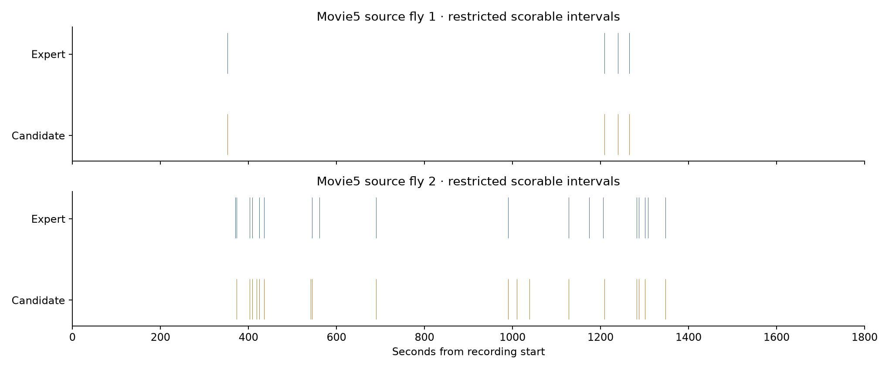

# FlyAggression Analyzer 2.2 — Days 3–6

22 October 2026 · PRJ 501 · Offline development study

**The calibration audit, annotation rebuild, fresh candidate fit and bounded temporal search were executed. No improvement was demonstrated.** The rebuilt data and candidate predictions equal Version 2.1. Physical arena dimensions remain nominal rather than independently measured. The existing app, launcher and frozen models remain unchanged.

| Day | Delivered | Target status |
|---|---|---|
| 3 | Calibration provenance, scale arithmetic, body/contrast settings, 36-feature distributions and sensitivity report | Per-recording physical measurement unavailable; corrected-calibration benefit cannot be established |
| 4 | Rebuilt labelled grids, source-boundary/offset checks and complete retained/excluded event accounting | Zero additional bouts recovered; increased coverage target unmet |
| 5 | Separately saved, freshly trained Random Forest and paired comparison | Reproducible candidate obtained; identical predictions, no data-quality benefit demonstrated |
| 6 | 27 temporal configurations, timing/error diagnostics and frozen candidate settings | Existing settings selected again; event improvement target unmet |

## Day 3 — calibration and feature consistency

The audit read each original calibration MAT, generation metadata and raw/converted feature files without rewriting them. All five recordings have 54,000 frames at 30 FPS. Saved pixels/mm equals `2 × arena radius in pixels / nominal diameter in mm`, and metadata agrees with the MAT values.

| Movie | Radius (px) | Nominal diameter (mm) | Pixels/mm | Mean body area (px²) | Mean major axis (px) | Contrast threshold |
|---|---:|---:|---:|---:|---:|---:|
| 1 | 65 | 16 | 8.125 | 97.0 | 18.96 | 0.4123 |
| 2 | 66 | 16 | 8.250 | 100.5 | 19.45 | 0.4573 |
| 3 | 66 | 16 | 8.250 | 106.0 | 19.51 | 0.4338 |
| 4 | 66 | 16 | 8.250 | 103.0 | 19.01 | 0.4596 |
| 5 | 65 | 16 | 8.125 | 151.0 | 22.18 | 0.3902 |

The 16 mm value comes from existing nominal cohort provenance in Version 2.1's source inventory and report. No per-recording physical measurement record was found among the supplied project records. The referenced thesis could not be fetched anew during this run, so this phase does not claim new verification of its contents. Image geometry alone cannot establish physical diameter. Values must not be generalized to unrelated uploads.

All scalar/array numerical body and contrast parameters are exported in `body-contrast-parameters.csv`, with calibration/raw/converted hashes in `calibration-audit.csv`. Movie 5 has a larger calibrated body size and lower contrast threshold; these differences merit inspection but do not prove calibration error. Existing boundary edge-support diagnostics range from 0.60 to 1.00; they are not physical-scale or segmentation-accuracy certificates.

Feature conversion was recomputed with the preserved adapter and matched all saved 36-feature arrays exactly, including nonfinite masks. Full-record per-fly median normalization remains part of that extractor; it is not a cohort-fitted scaler. This transductive within-record preprocessing is retained for baseline comparability and documented, while the model imputer is fitted only on training recordings.

Distributions use complete two-fly recording grids and report finite fractions and 1st/25th/50th/75th/99th percentiles. The largest across-record median ranges, divided by median within-record IQR, occur for transformed foreground/body ratio (2.32), velocity (0.97) and angular velocity (0.74). These are descriptive differences; behaviour mix, tracking and segmentation can contribute. They do not establish physical-scale causation. Per-record median-normalized features can have matching medians by construction, so matching medians alone is insufficient evidence of consistency.

### Scale sensitivity experiment

Hypothetical diameters of 14.4 and 17.6 mm (±10% from nominal 16) were applied to the same raw tracks/features. Because physical lengths and speeds divide by pixels/mm, these change by the diameter factor. Raw velocity, mean wing length, distance to wall, inter-fly distance and leg distance were scaled before running the unchanged adapter. Angles, angular velocities and ratios were held fixed. Distance to wall is discarded by the existing 36-feature schema.

The final 36-feature schema is sensitive primarily through inter-fly distance, leg distance and velocity plus their temporal filters. Mean wing length's uniform scale change cancels under per-fly median normalization (residual numerical error ≤4.5e-16). Velocity is log-transformed with an offset, so scale response is nonlinear near zero. Raw angles and other ratios are invariant in this fixed-track experiment.

This is **sensitivity analysis, not corrected calibration**. No invented diameter was selected to make recordings or scores agree. Changing scale during a complete tracker rerun can also alter physical-unit tracking thresholds, detections and identity flags; this experiment does not model those effects. Body/contrast thresholds were inspected, not experimentally optimized. A measured diameter and segmentation review are required before testing a defensible corrected calibration.

## Day 4 — annotation correspondence

Source lunge intervals were rebuilt with 1-based inclusive endpoints. Unknown annotations and any nonzero behavioural flag override positive/negative labels, including overlapping intervals. The independent boundary test includes a flagged interval overlapped by an unflagged one. Source annotation files were not edited.

The Day 1–2 reference-assisted candidate information was consumed. Since it supplied no accepted additional identity bridges, the same conservative correspondence masks were retained. Each complete reconstructed fly/frame grid equals its Version 2.1 baseline, including predictors, labels and reliability flags. Seven offsets from −3 to +3 frames were rechecked; zero offset has the lowest median best-pair trajectory error in all five recordings. This supports frame correspondence but is not independent biological identity certification.

| Recording | Source bouts | Retained | Remaining excluded | Recovered |
|---|---:|---:|---:|---:|
| movie1 | 71 | 60 | 11 | 0 |
| movie2 | 550 | 199 | 351 | 0 |
| movie3 | 426 | 265 | 161 | 0 |
| movie4 | 178 | 113 | 65 | 0 |
| movie5 | 303 | 124 | 179 | 0 |
| Total | 1,528 | 761 | 767 | 0 |

Per-source-bout causes and unresolved intervals remain in the Days 1–2 audit. This phase saves revised bout eligibility, retained whole expert events, full frame/event coverage and frame-offset tables for every recording. Whole-bout censoring and overlap closure are retained. Ambiguous aggressive-interaction identities remain excluded; no unsupported visual identity or behavioural labels were added.

Training remains movies 1–4: **410,956 eligible rows, 2,711 positives** (0.660%). Development selection remains movie 5: **100,479 eligible rows, 527 positives** (0.524%). Source row keys are unique and recording sets disjoint. Absent bouts remain inferred negatives under the original exhaustive-annotation assumption, not newly confirmed expert negatives. The revised dataset is a reproducible rebuild, not a larger or scientifically improved dataset.

## Day 5 — fresh candidate training

One fresh fit cloned the frozen Version 2.1 pipeline's estimator settings and used the rebuilt training data. Since no supported data correction was available, holding model settings fixed isolates the data-quality question and avoids an unrelated hyperparameter search. A freshly fitted model is saved separately at `models/raw-v2.2-candidate/lunge-detector.joblib`; it does not replace Version 2.1.

RF: 128 trees, unlimited depth, minimum leaf 1, sqrt feature sampling, bootstrap, seed 501, four workers. Negative class weight is 1; positive weight is 12.27144, equal to sqrt(training negatives / positives). Median imputation was fitted only on movies 1–4 and verified against their medians. No recording/frame/fly identifiers enter the ordered 36 predictors. Training took **49.46 seconds**. Serialized/reloaded probabilities were checked against saved scores.

At the unchanged probability threshold 0.15:

| Movie 5 development metric | Frozen 2.1 | Fresh 2.2 candidate |
|---|---:|---:|
| Frame precision | 55.67% | 55.67% |
| Frame recall | 70.78% | 70.78% |
| Frame F1 | 62.32% | 62.32% |
| Event precision | 78.95% | 78.95% |
| Event recall | 72.58% | 72.58% |
| Event F1 | 75.63% | 75.63% |
| Matched / false-positive / missed events | 90 / 24 / 34 | 90 / 24 / 34 |

Maximum absolute probability difference on the full 108,000-row movie 5 grid is **0.0**. The unchanged dataset and deterministic estimator reproduce the baseline. This does not demonstrate that corrected calibration or improved correspondence would be ineffective; those corrections were not available here.

Frame confusion matrix, true rows and predicted columns ordered [0,1]: `[[99655,297],[154,373]]`. Frame metrics use eligible rows; event metrics use the stricter common whole-bout evaluation coverage. Movie 5 retains only 124 of 303 expert bouts (40.92%).

## Day 6 — temporal events and errors

A predeclared 27-setting grid tested median windows {1,3,5}, gap allowances {0,1,2} frames and minimum durations {1,2,3} frames at threshold 0.15. Selection used movie 5 event F1, then precision and recall, then smaller temporal parameters. The same Version 2.1 choice won: **median 3, gap 1, minimum duration 3**. Event matching uses IoU ≥0.30 and common coverage. No final-test data were used.

Selected predictions number 114, with durations from 3 to 10 frames (median 4). Among 90 matched events, median absolute onset error is 0 frames and median absolute offset error is 1 frame. There are 24 false positives and 34 missed retained expert bouts. No expert bout overlaps multiple predictions; one prediction overlaps multiple expert bouts. Overlap topology indicates cases to inspect, not proof of biological fragmentation or merging. Eighteen of the 24 false positives last 3–4 frames; 33 of the 34 missed expert bouts last 4 frames (the other lasts 3). One false positive overlaps a retained expert bout but fails matching; two missed bouts overlap a prediction but fail matching. A simple duration cutoff cannot reliably separate these groups. Detailed probability traces, frame processing, predicted/expert outcomes, matches and signed timing errors are exported.

The configuration and model hashes are frozen together under `models/raw-v2.2-candidate/`. This is an offline candidate freeze, not a release or runtime integration. Version 2.1 remains the active software.

## Verification, artifacts and limitations

The independent verifier checks all 20 selected source files against the original inventory, all 540,000 annotation fly/frame labels, exact complete-grid parity, exact event coverage/truth parity, disjoint splits, dataset/model hashes, training-only imputer medians, reloaded probabilities and recomputed selected event metrics. All 14 Version 2.2 unit tests and 26 preserved Version 2.1 regression tests pass. Unit tests include scale-only changes, invalid scale, leakage, duplicate keys, inclusive endpoints, invalid boundaries and sticky flagged overlaps, alongside the seven existing identity tests. Verification logs and JSON receipts are in `reports/v22-days3-6/`.

Main artifacts:

- `config/v22-days3-6.json`: fixed protocol and provenance.
- `data/v22-revised/`: locally saved ignored labelled grids and training/validation parquet; hashes in the report's dataset manifest.
- `reports/v22-days3-6/`: calibration parameters, feature profiles, hypothetical sensitivity, alignment/event accounting, comparison, temporal search, figures and verification.
- `models/raw-v2.2-candidate/`: separate trained model, configuration and freeze manifest.
- `scripts/v22/days3_6.py` and `finish_days3_6.py`: runnable analysis and independent checks.

Run from this worktree with `../drosophila-aggression/.venv/bin/python`. Execute `scripts/v22/days3_6.py`, then `scripts/v22/finish_days3_6.py`; tests use `-m unittest discover -s tests/v22 -v`. Inputs are read from the existing Version 2.1 dataset and original source collection; this is not a standalone data package. Each analysis saves per-recording calibration hashes/parameters and a source manifest; no application-flow changes were made.

**Unresolved:** independently measured arena dimensions, expert confirmation of ambiguous identities, increased usable coverage, new untouched recordings and improved detection. Movies 1–5 are development recordings; movies 6–10 were previously consumed and remain excluded. Movie 5 was reused for development selection, so these figures are not independent final-test performance. No claimed accuracy gain, coverage gain or calibration correction is supported by this phase.
