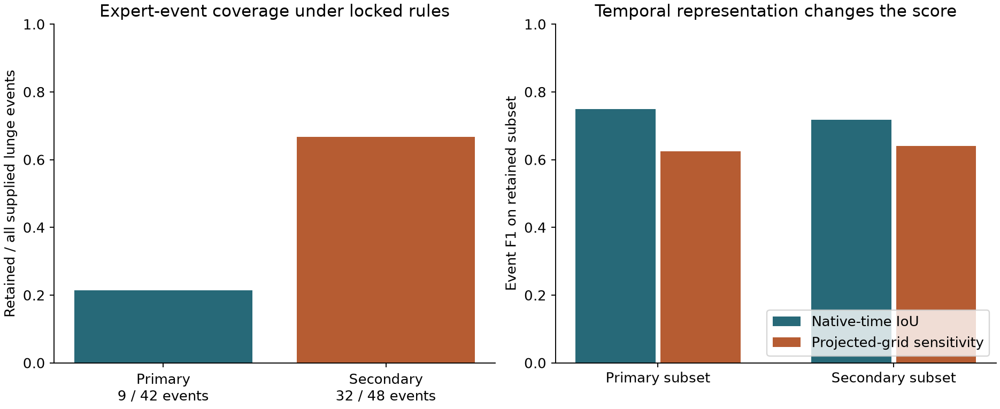
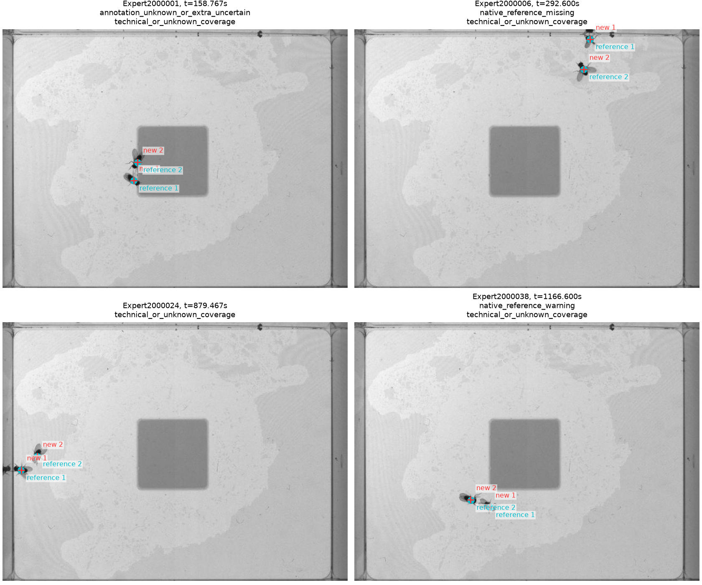
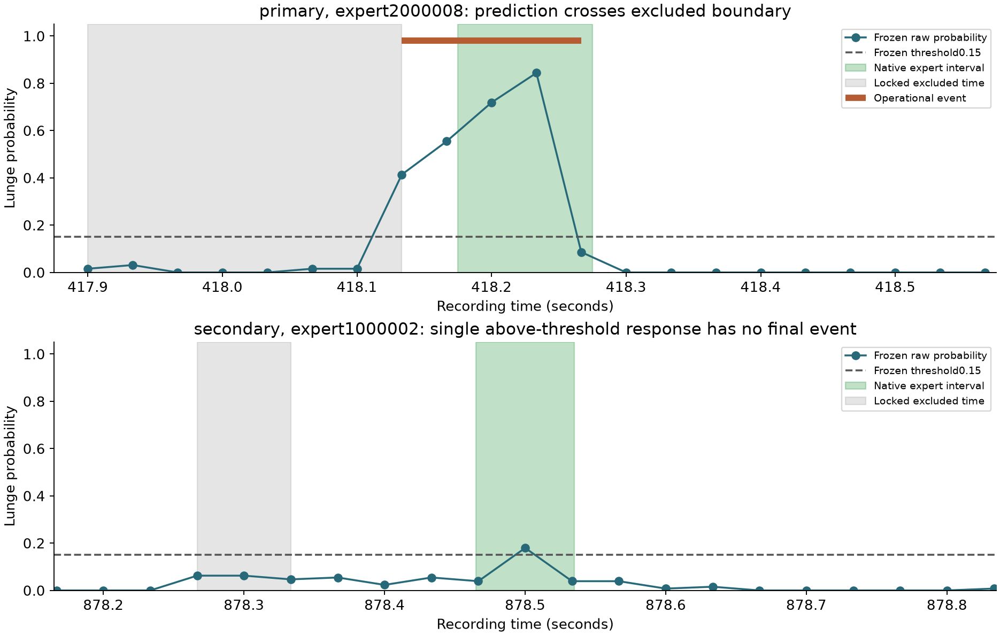
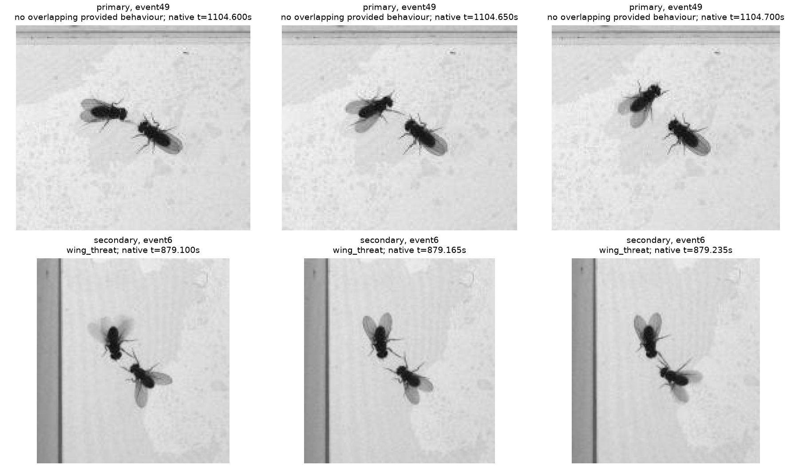

# FlyAggression Analyzer Version 2.3 — Days 5–8

Completed 2026-10-25 on branch `v2.3`. The frozen Version 2.2 model was evaluated once on the Boy Meets Boy starter recording after eligibility and scoring rules were committed. **This is a restricted-subset external evaluation, not whole-recording accuracy or proof of generalization across Boy Meets Boy.** No training, threshold selection, model replacement or event-rule tuning occurred.

## Main result and coverage

The detector generated **64 operational events** on the complete two-fly, 38,390-frame analysis grid. The main primary-annotation score is **event F1 0.7500**, but only **9/42 expert events (21.43%)** were retained and only **7/64 operational events** were scorable. The secondary set retained **32/48 expert events (66.67%)**, scored **46/64 operational events**, and yielded **event F1 0.7179**. Fifty-seven primary and eighteen secondary operational predictions were excluded as whole events; they were not counted as false positives or silently discarded.

The primary set's three false-negative counts all have an existing operational response with native-time IoU above 0.30. Those responses crossed locked evaluation coverage boundaries and were excluded. These are consequences of the fixed scoring-boundary policy, **not evidence that the detector produced no response**. Consequently, neither the primary F1 nor its recall should be described as pure classifier performance independent of coverage handling.

| Annotation scope | Expert events retained | TP | Unmatched predictions | Unmatched expert events | Event precision | Event recall | Native-time F1 | Grid sensitivity F1 |
|---|---:|---:|---:|---:|---:|---:|---:|---:|
| primary | 9/42 | 6 | 1 | 3 | 85.71% | 66.67% | 0.7500 | 0.6250 |
| secondary | 32/48 | 28 | 18 | 4 | 60.87% | 87.50% | 0.7179 | 0.6410 |
| primary-common | 9/42 | 6 | 1 | 3 | 85.71% | 66.67% | 0.7500 | 0.6250 |
| secondary-common | 9/48 | 6 | 1 | 3 | 85.71% | 66.67% | 0.7500 | 0.6250 |

Common-mask rows additionally use the same time mask and whole-bout closure across both annotation sets. Both then retain nine source events and produce the same event counts and F1. This supports a substantial role for coverage and annotation eligibility in the difference between the two main results. It does not establish that the annotations or model are universally correct.

## Day 5 — Alignment and protocol locked before predictions

The protocol was committed as `4025d01` before model deserialization. Lock SHA256: `313a48ff3096083321a915d462eea199285dcbbf26b23cb7b3160c2ec6874e8b`. The immutable lock records feature/model/config/runtime hashes, masks, retained/excluded source bouts and both annotation files. Source bounds remain 1-based inclusive native frames; times are half-open `[(start-1)/200, end/200)`. Prediction times are `[(start-1)/30, end/30)`. The original 200-to-30 FPS mapping was retained with no frame offset adjustment.

Relative fly correspondence reuses the Day 4 geometric rules unchanged. All native reference positions must be finite and unflagged across each expert event and all touched analysis-time bins. Joint finite new positions/features, tracking warnings and stable correspondence are required. Technical invalidity is padded by two analysis frames for feature context. Explicit `unknown` annotations and nonzero/nonfinite extra columns of unverified meaning are conservatively excluded; extra values are preserved, not asserted to be known biological flags. Excluded source bouts censor both streams with overlap closure. **Short events were not excluded merely for retaining fewer than three samples.**

Primary exclusions: 33 source events, including 29 affected by annotation unknown/unverified-extra uncertainty, one by native reference missingness, one by native reference warning and two by other technical coverage. These cause flags overlap the technical/unknown coverage category; they are not additive independent causes. Secondary exclusions total 16, including eight unknown/unverified-extra cases, one native-reference-missing case and seven other technical cases. `exclusion-reason-counts.csv` and the complete source-bout CSVs retain every event and its reason.

Position examples around uncertain intervals were inspected before inference. Centroids often agree at a representative frame even when uncertainty occurs elsewhere in the complete event/context. A still image cannot certify biological identity or overturn an interval-level warning; no assignments or exclusion rules were changed from those inspections.

## Day 6 — Unchanged frozen-model inference

Model SHA256: `8be5bf703442f1035fadc0ae23a0215c8d61b7257de18b54d764adbe57219909`. The existing fitted pipeline, including its imputer, scored all **76,780 fly/frame rows**, including **5,303 rows with missing source features**. Its saved imputer statistics were identical before and after prediction. Threshold **0.15**, median window **3**, maximum merged gap **1 frame**, minimum event duration **3 frames** and feature engineering version **0** remained unchanged. No feature preprocessor was fitted to Boy Meets Boy.

Inference took 1.294 seconds for the already extracted feature dataset; this excludes video conversion/tracking. Probabilities, threshold decisions, full-grid processed outputs and operational event onset/offset/duration/native fly ID are saved. Relative reference IDs are attached only where stable technical correspondence permits, with no biological identity certification. The fitted imputer generated finite scores for missing-feature rows; those rows are explicitly flagged and excluded from reliable evaluation. None of the 64 operational events touches missing features, although ten fail the stricter joint technical mask.

Labels did not alter operational probabilities or smoothing. The model/runtime/config bytes remained unchanged. Full probabilities and processed frames reside in ignored local `data/v23-predictions/`; hashes are recorded in `inference.json`.

## Day 7 — Matching, frame metrics and annotation differences

Main scoring uses maximum-cardinality, then maximum-IoU one-to-one matching within the recording and native output fly ID, at **IoU ≥ 0.30**. Expert endpoints retain their native 200 FPS times. Predictions are scored only when the **whole fixed operational event** lies in a scorable interval with stable relative mapping; events are never clipped or re-smoothed against labels. Excluded predictions are exported with reasons.

This differs from the older development evaluation, which used projected 30 FPS expert endpoints and detection after coverage masking. Both differences were declared before prediction. The separately declared projected-grid sensitivity gives F1 **0.6250 primary** and **0.6410 secondary** on the same retained sets and fixed predictions. Native-time scoring was not chosen after seeing its higher values; it preserves the original annotation durations. The sensitivity shows that temporal representation materially affects the numerical conclusion.

Frame metrics below compare the raw frozen threshold decision to source lunge labels sampled on the analysis grid. **They are conditional on exhaustive supplied lunge labelling outside explicit unknown intervals. Absence of a lunge annotation is not a separately confirmed expert negative.** They are not an unqualified frame-accuracy claim. Confusion matrices, per-fly results and complete frame outcomes are saved.

| Annotation set | Scorable fly/frame rows | Conditional frame precision | Conditional frame recall | Conditional frame F1 |
|---|---:|---:|---:|---:|
| primary | 61,202 | 27.63% | 91.30% | 0.4242 |
| secondary | 65,844 | 23.92% | 98.63% | 0.3850 |

Matched-event timing errors (positive signed errors mean later/longer predictions; table shows median absolute errors):

| Annotation set | Onset error (ms) | Offset error (ms) | Duration error (ms) |
|---|---:|---:|---:|
| primary | 30.83 | 15.83 | 62.50 |
| secondary | 30.83 | 32.50 | 75.00 |

Across all original source intervals, one-to-one primary-versus-secondary annotation matching finds 42 pairs out of 42 primary and 48 secondary bouts at native IoU ≥ 0.30, descriptive agreement F1 0.9333. This is agreement between two annotation sets, not adjudicated expert accuracy. Six secondary bouts have no primary counterpart under that criterion. Different unknown/unverified-extra intervals and temporal boundaries still produce different evaluation populations.

## Day 8 — Evidence-supported failure analysis

- **Coverage is the strongest constraint on interpretation.** Primary rules retain only 21.43% of provided lunges. All three primary unmatched expert intervals already overlap operational predictions at IoU approximately 0.64; whole-prediction boundary exclusions cause those misses in the strict metric. They should not be attributed to classifier silence.
- **Temporal filtering/timing affects the secondary misses.** All four retained secondary misses have only two selected 30 FPS samples. One has a single raw above-threshold response without a final event; the others overlap operational events at IoU approximately 0.25–0.28, below 0.30. Two nearby expert bouts are covered by a longer predicted interval. These observations implicate temporal support and event boundaries; they do not prove a single cause.
- **Downsampling does not make these particular native events mathematically unmatchable.** All 42 primary and 48 secondary bouts retain at least one sample. Eighteen primary and 33 secondary bouts retain at most two samples. Exact 600 Hz-lattice diagnostics show an optimally placed 30 FPS event of at least three frames could reach IoU 0.30 for every source bout. Actual filtering and boundary placement still matter.
- **Unmatched predictions are not independently adjudicated biological false positives.** The one primary unmatched prediction overlaps no other provided behaviour label. Of 18 secondary unmatched predictions, two overlap primary lunge intervals and one overlaps a secondary `wing_threat` interval. This supports annotation/timing or behaviour-confusion hypotheses, not proof of non-aggressive behaviour. Wing threat is itself aggression-related; it must not be called a confirmed non-aggressive interaction.
- **Feature shifts and tracking uncertainty remain material.** The Day 4 descriptive comparison found shifts in wing angles, inter-fly distance, foreground/body ratio and other inputs versus training recordings. The initial 87.7-second missing-fly interval also exists in the reference. Nominal 12 pixels/mm remains unverified per recording, and matching feature names does not certify equivalent biological measurements. Error medians and tracking-context diagnostics are provided, but these data cannot causally separate tracking, feature extraction and classification effects.

The original 200 FPS source frames were also inspected around representative unmatched predictions, including the sole primary unmatched event and a secondary event overlapping a wing-threat annotation. The figure below provides spatial/wing-motion context only. These stills do not establish that the unlabelled event was non-aggressive or supply new expert labels.

## Development comparison and limits

Earlier Version 2.2 development results on Aggression/movie 5 were frame F1 0.6232 and event F1 0.7563, with 124/303 expert bouts retained (40.92%). That recording was used during development selection. Boy Meets Boy/movie 5 is an externally collected, lunge-count-selected starter recording with a different arena, frame rate, nominal scale, annotation conventions, coverage and scoring protocol. The primary event F1 0.7500 here is **not evidence of equivalent full-recording performance**, improvement, or expert-equivalent quantification. No pooled comparison is justified. Conditional frame F1 is lower here, but changing conditions prevent a causal attribution to domain shift alone.

This work completes the requested alignment, frozen inference, restricted external evaluation and diagnostic deliverables. It does not resolve physical scale, biological identity, annotation exhaustiveness or full-recording validity. It supports a scientifically qualified external evaluation on a single selected recording. Future changes motivated by these results belong in a separate candidate and require different evaluation recordings; this recording is now examined and cannot remain an untouched test after adaptation.

## Verification

All 21 Version 2.3 tests passed, including the 11 new coverage/matching, inference-guard and temporal-limit tests. Six inherited alignment tests also passed. Final verification reconciled every source event, scored/excluded operational prediction, one-to-one match and frame-grid row; all locked inputs, prediction files and frozen models matched their recorded hashes. The 585 frozen Version 2.2 tracked files, nine original model/runtime files, release launchers and inherited Days 1–4 files remained unchanged.

Independent read-only review found no material scoring or report inconsistency. Exact 600 Hz integer-lattice threshold checks agree with floating-time IoU decisions for every current candidate pair. A future exact-threshold regression/hardening improvement is recorded; locked scoring code and current results were preserved.

## Inspect and reproduce

`config/v23-evaluation-lock.json` and `inference.json` establish the lock-before-prediction sequence. `performance-table.csv`, `per-fly-performance.csv`, source/expert/prediction outcome CSVs, exclusion masks, timing errors, disagreement matches and `failure-analysis.json` retain the detailed evidence. See [REPRODUCE-V23-DAYS5-8.md](REPRODUCE-V23-DAYS5-8.md) for commands and data locations. No Streamlit integration or release replacement was part of Days 5–8.
