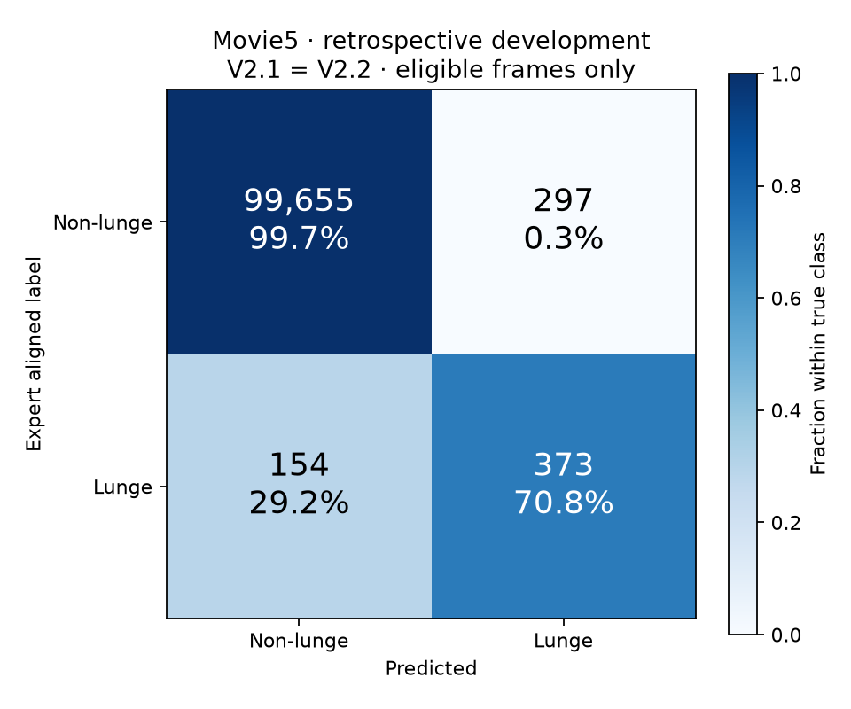
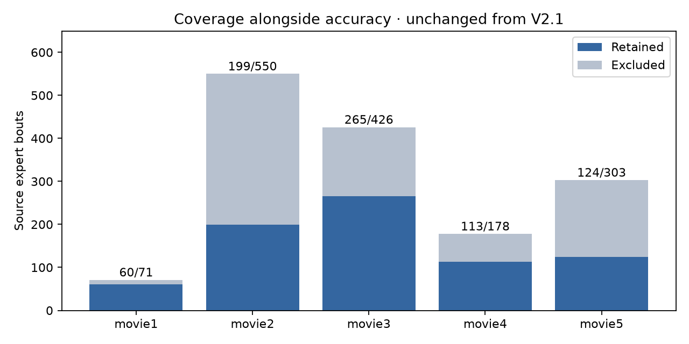
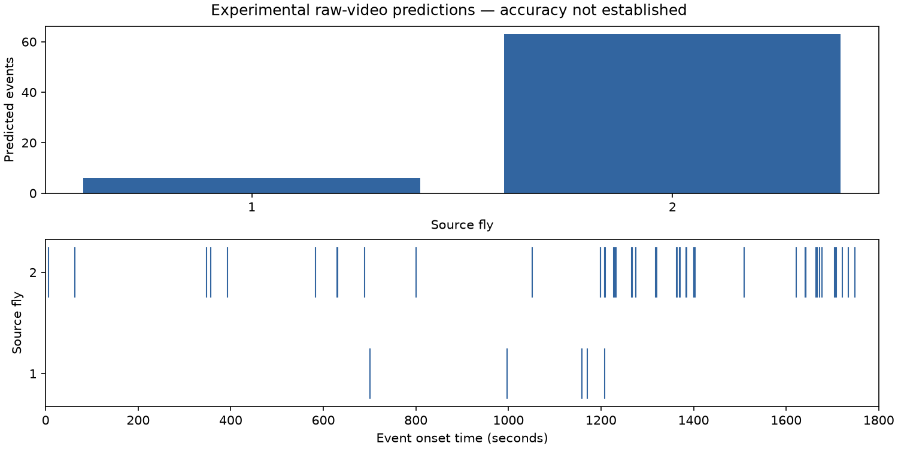

# FlyAggression Analyzer Version 2.2 — Final Progress Report

23 October 2026 · PRJ 501 · Research prototype · Retrospective evaluation

## Outcome

A separately frozen Version 2.2 application and model are available with both analysis modes, reproducible exclusion/calibration audits, labelled dataset rebuild, a fresh classifier fit, fixed retrospective evaluation and a new complete MP4 demonstration. **No accuracy, usable-annotation coverage or biological identity improvement was demonstrated over Version 2.1.** No genuinely untouched expert-annotated recording was available in the supplied collection. The original feature classifier, Version 2.1 release and default Desktop launcher remain unchanged.

## Days 7–10 status

- Day 7: The candidate and evaluation protocol were locked before this phase's scoring. Independent-data success criterion is unmet; the approved retrospective fallback was used. Supplied benchmark movies 1–10 were already consumed; reference/example clips lacked the required independent expert correspondence. No expert labels or physical measurements were fabricated.
- Day 8: Frozen models were scored under identical features, masks, thresholds and event matching. All paired probabilities are equal. Movies 1–4 are training resubstitution and movie5 was previously used for development selection. These results establish reproducibility, not independent generalization.
- Day 9: The Version 2.2 raw model is separately routed in the local app; original MATLAB features use the original classifier. Automatic calibration, fresh tracking/features, inference and CSV/PNG/ZIP exports passed a full movie1 functional run. Regression, input and UI checks accompany the release.
- Day 10: Model/configuration freeze, performance tables, confusion matrices, timelines, installation/user/demo guidance, a separate research package and PRJ501 presentation materials are saved. The label “Version 2.2” identifies this audited research build, not a proven accuracy upgrade.

## Locked scientific method

The existing raw-video-specific classifier was freshly refitted in Days3–6 on movies 1–4 using the same36 features and estimator settings:128 trees, unlimited depth, minimum leaf1, sqrt feature selection, seed501. Median imputation was fitted only on training rows. Whole-recording per-fly median normalization in the existing extractor remains documented; no validation-fitted cohort scaler was added.

This phase performed no fitting or parameter selection. Threshold0.15, median3, merge gap1, minimum span3 frames and event IoU0.30 were locked with model/config hashes. The saved Day1–4 reference-assisted masks are used only for retrospective annotation correspondence; they are not an autonomous identity-correction feature in production. Full-video inference does not read expert annotation files. Post-inference reference comparison is an audit.

## Paired retrospective measurements

Versions 2.1 and2.2 have identical values in every row below. Training results must not be pooled with movie5 and presented as generalization accuracy.

| Recording | Evaluation role | Frame F1 | Event F1 | Event TP / FP / FN |
|---|---|---:|---:|---:|
| movie1 | Training resubstitution | 96.08% | 95.65% | 55 / 0 / 5 |
| movie2 | Training resubstitution | 85.84% | 89.09% | 196 / 45 / 3 |
| movie3 | Training resubstitution | 91.01% | 94.37% | 260 / 26 / 5 |
| movie4 | Training resubstitution | 87.25% | 88.61% | 105 / 19 / 8 |
| movie5 | Retrospective development | 62.32% | 75.63% | 90 / 24 / 34 |

Movie5 frame precision55.67%, recall70.78%, F162.32%; event precision78.95%, recall72.58%, F175.63%. Event counts:114 predicted,124 retained expert,90 matched,24 false positives and34 misses. Frame confusion matrix, true rows/predicted columns [non-lunge,lunge]: [[99655,297],[154,373]]. Scores use the same selected reliable subset; they are not full-recording biological performance. The original feature-model79.53% eventF1 belongs to its separate earlier evaluation and is not evidence for this raw-video release.

## Coverage, calibration and identity

Across movies 1–5,761 of1528 source expert bouts are retained and767 excluded. Movie5 retains124/303 (40.92%). No additional safe identity corrections or bout recoveries were supported. Exclusions have explicit overlapping causes and exclusive primary categories in the Days1–2 audit. Native tracking warnings, context buffers and short stable intervals account for substantial losses. Source IDs may switch; biological identity continuity is not certified.

Nominal 16 mm arena diameter was inherited from cohort provenance, not independently measured per recording. Saved scale arithmetic is consistent: movie1/5 use8.125px/mm, movies2–4 use8.25px/mm. Body and contrast parameters and36-feature profiles are recorded. Fixed-track ±10% scale sensitivity identifies distance/leg-distance/velocity dependence; it is not corrected calibration or evidence of better tracking. No diameter or contrast threshold was tuned to improve F1.

## Fresh raw-video functional demonstration

The full30-minute movie1 training-source MP4 was freshly processed through automatic geometry calibration, Caltech FlyTracker, feature conversion and the frozen Version 2.2 model. The benchmark nominal 16 mm assumption is explicitly retained. It produced two tracks ×54,000 frames ×36 features.

Measured total runtime: **250.1 seconds (4.17 minutes)**, including automatic calibration **26.0s** and tracking/adapter/prediction **222.8s**. This is one measurement on this Mac, not a promise for uploads of other length/codec/quality.

Exports contained **69 predicted events** and **11.30 summed fly-seconds**. Inclusive durations, contiguous frame keys, count totals and per-fly/fly-minute frequency denominators were independently checked. PNG decoding and ZIP member-byte parity passed. On these fresh features, frozen Versions 2.1 and 2.2 again give identical predictions and 69 events. The prior fresh Version 2.1 run produced 68 events: 198 finite feature values differ from the cached extraction, showing upstream tracking repeatability limitations, not a classifier gain. Source identity reliability was audited after inference; it remains uncertain and no full-video accuracy is claimed. The functional demo uses a training recording and must not be called an independent test.

## Software and release

Original MAT mode preserves the frozen original model; known raw-adapter feature MATs are rejected in that mode. Raw MP4 mode uses only the Version 2.2 hash/schema/adapter-checked model, with separate provenance and experimental warnings. Automatic geometry still requires a physically known diameter and user boundary confirmation. Supported/tested conditions are one circular arena, two flies,30FPS and readable MP4;200MB UI limit;30-minute analysis timeout. No additional behaviours are supported.

The separate Desktop Version 2.2 launcher uses port8504. Existing Version 2.1 launcher/port remains untouched. The extracted research package launcher uses port8505 and requires local Python dependencies and licensed compatible MATLAB; neither environment nor MATLAB is bundled. Included FlyTracker binaries are platform dependent. See INSTALLATION-V22.md and DEMONSTRATION-V22.md.

Tests and checks are saved under reports/v22-days7-10: original and Version 2.1 regression logs, Version 2.2 routing/UI tests, invalid-input results, quantification audit, evaluation lock/hash check and package verification. Source preservation checks cover438 Version 2.1 files, the Version 2.1 release archive, default Desktop launcher and original model/runtime integrity. Code review found no material routing or evaluation-scope issue.

## Remaining scientific requirements

Independent raw recordings with expert per-fly annotations, physical arena measurements and reviewed identities are still needed. More permissive exclusion masks would increase apparent coverage without establishing label reliability and were not used. Further work should address source tracking/annotation ambiguity before claiming an improved detector. Version 2.2 is a functional, reproducible research delivery with transparent limits; the planned independent-data, improved-coverage and higher-accuracy targets remain unmet.

## Inspectable sources

- config/v22-evaluation-lock.json: pre-scoring protocol and frozen hashes.
- reports/v22-days7-10/performance-by-recording.csv, evaluation-coverage.csv and frame-confusion-matrices.json: paired numbers and scope.
- reports/v22-days7-10/evaluation/: per-record scores, events and source matches.
- reports/v22-days7-10/full-movie1/verification.json and exports/: fresh functional run and downloads.
- DAYS1-2-REPORT.md and DAYS3-6-REPORT.md: exclusion, calibration, annotation and model-development evidence.
- models/raw-v2.2/ and models/raw-v2.2-candidate/: frozen release and source candidate.
