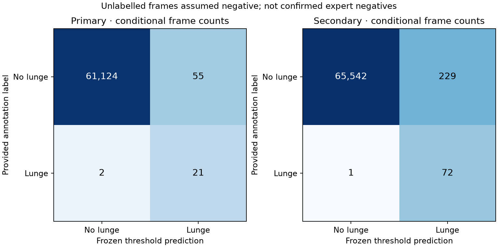
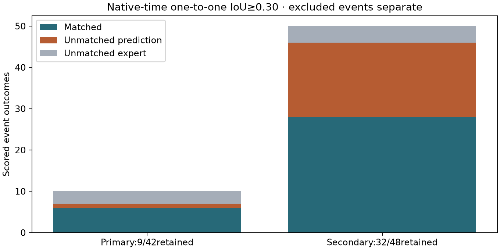
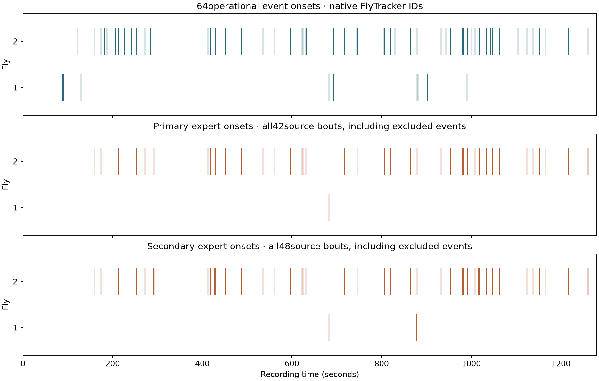

# FlyAggression Analyzer Version 2.3
## Cross-Dataset Validation Research Prototype — final report

Delivered 2026-10-26. The application now connects high-frame-rate rectangular video import to calibrated tracking, 36-feature extraction and the **unchanged frozen Version 2.2 Random Forest**. Original MATLAB-feature analysis and circular 30 FPS processing remain available. This is a functional research release with qualified external evaluation; it is not expert-equivalent whole-video biological quantification.

### Fresh end-to-end verification

The complete Boy Meets Boy movie 5 AVI was processed afresh through the same backend invoked by the new app route: **255,929 native frames at 200 FPS → 38,390 analysis frames at 30 FPS → two tracking streams → 36 features → 64 predicted events**. Processing took 11.97 minutes on this machine. Native source file hash was unchanged before/after processing. All selected decoded YUV pixel hashes matched after lossless import, and all output timestamps matched the 30 FPS grid within printed timestamp precision. No spatial resizing or frame interpolation was used.

The source format remains 640×480, 8-bit YUV420 with its declared color space. Native sample-time jitter is at most 1.67 ms; annotation/event endpoint quantization is separate and can approach 30 ms. The analysis duration has a 21.67 ms grid-tail extension. Source/analysis indices and times are exported in `frame-time-map.csv`.

Fresh versus prior locked-run feature missingness masks are identical. Maximum finite feature difference: **0.0**; maximum probability difference: **0.0**; event-count difference: **0**. The fresh run predicts 9.4333 summed fly-seconds of lunges. This verifies functional/numerical reproducibility for this examined recording, not a new untouched validation dataset.

The app exports event counts, onsets/offsets, durations, per-fly frequency, all frame predictions, native-frame lookup, calibration MAT/parameters, quality/provenance JSON, PNG and ZIP. CSV accounting, PNG decoding and ZIP contents passed checks. A real legacy circular upload regression also passed on a 300-frame known-source clip. A separate rectangular upload-service excerpt verifies the uploaded filename/provenance path; its verification receipt is included when complete.

### Frozen external study — coverage must accompany accuracy

These results are the original pre-locked study. The app displays them separately from current input predictions. Native-time, cardinality-first one-to-one IoU ≥ 0.30 was specified before inference; no model fitting, threshold tuning or event-rule changes used Boy Meets Boy labels.

| Annotation set | Expert bouts retained | Event precision | Event recall | Event F1 | Conditional frame F1 |
|---|---:|---:|---:|---:|---:|
| primary | 9/42 | 0.8571 | 0.6667 | 0.7500 | 0.4242 |
| secondary | 32/48 | 0.6087 | 0.8750 | 0.7179 | 0.3850 |

Only 7/64 operational predictions are scorable under the primary mask, versus 46/64 under the secondary mask. **All three primary FN counts have operational responses with IoU ≥ 0.30 that were excluded at locked coverage boundaries.** They are not failures to produce a response. Common-mask event results agree between annotators. Projecting expert bounds to the 30 FPS sample grid gives lower sensitivity F1 values, 0.6250 and 0.6410; native-time scoring was not chosen after inspecting these values.

Frame metrics assume exhaustive lunge labelling outside uncertainty; absence of a label is not a confirmed expert negative. Conditional confusion matrices therefore must not be presented as unrestricted biological accuracy. Earlier development F1 0.7563 on 124/303 Aggression movie 5 bouts came from a different, development-selected dataset and scoring protocol. Direct performance-improvement claims are unsupported.

### Application scope and safeguards

- Original feature mode uses the frozen original 1.0 model; raw-adapter MATs remain rejected there.
- Circular MP4 mode preserves its existing 30 FPS automatic/uploaded calibration route and frozen 2.2 model.
- New rectangular mode supports tested constant 30/200 FPS, 8-bit YUV420 AVI/MP4. A local-file option handles the 7.3 GB starter without loading it into a browser upload. Uploaded videos retain the 200 MB limit.
- Manual inclusive rectangular bounds, padding, pixels/mm and scale provenance are explicit. Source/analysis FPS and calibration/quality details are displayed. Defaults are identified as starter-specific, not universal physical measurements. Nominal 12 px/mm remains unverified per recording.
- Invalid formats/rates, VFR timestamps, outside/full-image masks, missing scale, preview decode failures and pipeline failures produce errors. Failed run logs are retained; incomplete runs cannot be loaded as completed results. Renamed uploads invalidate stale display identity. No alternate model is silently substituted.
- The completed starter button is explicitly a saved demonstration, not fresh analysis of the selected input. Locked evaluation is separately labelled.

The saved model threshold remains 0.15 with median window 3, merged gap 1 frame and minimum duration 3 frames. Model SHA256: `8be5bf703442f1035fadc0ae23a0215c8d61b7257de18b54d764adbe57219909`. Original feature model SHA256: `508f49002159bb6da8be4c42f38c76ba43215b692e96aa73276e287cedb86a42`.

### Reliability and limitations

Physical scale is nominal or user-supplied, not independently measured by software. Fly identities can switch; matching geometric trajectories does not certify biological continuity. Initial missing tracking and nonfinite measurements are retained and flagged; the frozen fitted imputer is not new evidence of valid tracking. Short events can lose temporal support during downsampling. Unmatched predictions remain unadjudicated biological false positives; wing threat is aggression-related, not a confirmed non-aggressive label.

One lunge-count-selected external recording and restricted coverage do not establish generalization to all Boy Meets Boy or other assays. The recording is now examined; adaptations motivated by it require different evaluation data. No model or threshold was changed in this release. The locked evaluation inputs and results remain preserved even though the application was extended.

### Delivery and verification

The source worktree remains on separate branch `v2.3`. Frozen Version 2.2 software/model, prior archive and existing Desktop launchers remain unchanged. `config/v23-release-freeze.json` pins application/runtime/model files; the separate release package has `SHA256SUMS.json` and `verify_package.py`. Python/MATLAB/FFmpeg and large raw videos are not bundled.

See `INSTALLATION-V23.md`, `USER-GUIDE-V23.md`, and `DEMONSTRATION-V23.md` for installation, live/fast demonstrations and limitations. Machine-readable evidence is in `reports/v23-days9-10/`, with prior scientific detail in `DAYS5-8-REPORT-V23.md`. Tests cover current app/service/routing, timestamp conversion and rectangular validation, preserved legacy modes, corrupt inputs and exports. Package relocation/ZIP and final hash checks are recorded separately; completion claims rely on their PASS receipts.
