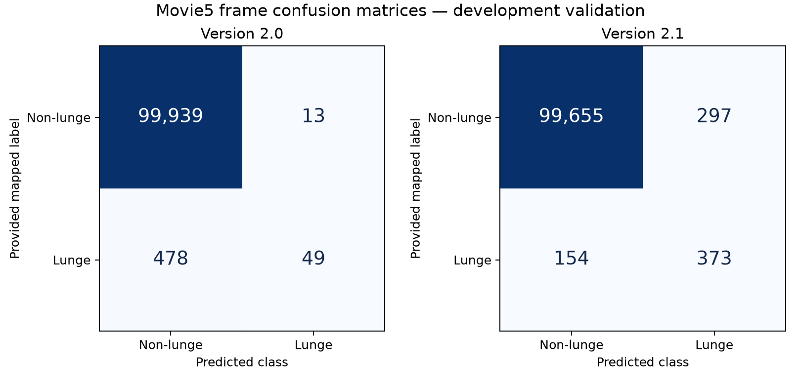
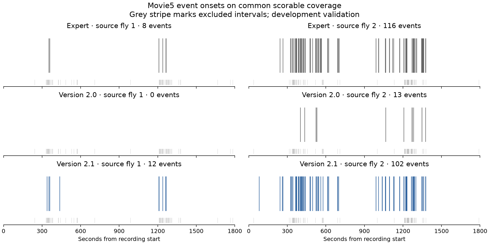

# FlyAggression Analyzer Version 2.1 — Final Project Progress Report

PRJ 501 · 21 October 2026 · Days 1–10 completed for the documented research-prototype scope

## Project outcome

FlyAggression Analyzer Version 2.1 is a tested local research prototype supporting raw MP4 analysis and the original MATLAB feature workflow. The selected raw-video model, preprocessing and postprocessing remain frozen. Days 9 and 10 tested the complete software path and prepared a reproducible release. This is a research deliverable, not a certification of biological accuracy.

## Frozen model and workflows

Raw MP4 → automatic arena calibration → pinned Caltech FlyTracker → 36-feature adapter → Version 2.1 Random Forest → event detection → counts, durations, frequencies, timelines and exports. Compatible original MATLAB features → original frozen Version 1.0 classifier → its original postprocessing. Training movies: 1–4. Development selection recording: movie5. No newly untouched final-test recording is available. Movies6–10 were previously examined and were not used for this final run or retuning.

## Full-length MP4-to-report test

A fresh 30-minute movie1 MP4 was processed from automatic calibration through new tracking, feature extraction, frozen inference and report export. Calibration took 22.8 seconds; tracking, conversion and prediction took 220.7 seconds; total audited run took 244.8 seconds (4.08 minutes). The result contained 108,000 ordered fly-frame rows, 68 predicted events and 11.200 summed fly-seconds in predicted lunges. This was a training-source functional test, not an independent accuracy evaluation. Runtime is a single measurement on this machine, not a guarantee for arbitrary uploads.

## Quantification and export verification

The independent audit reconstructs inclusive event duration as (end−start+1)/30, onset as (start−1)/30 and exclusive stop as end/30. It checks event-to-frame membership, non-overlapping per-fly events, per-fly counts, summed durations, recording counts and per-fly-minute frequency denominators. CSV tables were read back, the PNG was decoded, and every ZIP member was checked byte-for-byte against its source export. Both source tracks retain consecutive frames 1–54,000. Event counts sum both source flies; simultaneous bouts can overlap in wall-clock time.

## Regression and invalid-input testing

The final Version 2.1 regression suite passed 26 tests; the unchanged original-workflow suite passed 55 tests. Nine real service-level invalid-input cases were handled: empty MP4, wrong extension, missing consent, missing calibration, invalid physical diameter, corrupted MP4, incompatible 15 fps MP4, corrupted calibration MAT and corrupted feature MAT. Missing or altered releases and model/configuration mismatches also have regression coverage. The original movie5 MATLAB example still produces 325 events using the original model hash. No unhandled failures occurred in the one valid full-run check and these nine rejected-input cases; this small test set does not estimate a population reliability rate.

## Routing bug fixed

Known adapter-generated MAT files carry feat.integration_status. Version 2.1 now rejects those files in original-feature mode instead of silently applying the original classifier. Accepted original files still delegate to the unchanged original runtime. The guard cannot identify arbitrary externally generated features after provenance markers are stripped; numerical compatibility remains the user’s responsibility. The frozen original model, raw model, their configurations, adapter and automatic calibration sources were not modified.

## Equivalent-condition development evaluation

Both frozen models were rerun on the exact same newly extracted movie5 feature file. Predictions were generated on the complete 108,000-row grid without annotations. Frame scoring then used the same 100,479 reliable mapped rows (527 positive frames); event scoring used the same 100,425 rows after whole-bout censoring, retaining 124 of 303 source bouts. IoU threshold was 0.3 and event matches were one-to-one. The newly generated probabilities reproduce the earlier frozen artifacts within 1e−14. No fitting, model selection or threshold tuning occurred during Days 9–10.

## Interpreting the comparison

The selected Version 2.1 development result has frame F1 62.32% and event F1 75.63%, versus Version 2.0 operating on these same new features at 16.64% and 16.06%. Version 2.1 predicts 114 events against 124 retained expert bouts: 90 matched, 24 false positive and 34 missed. The net count difference of −10 hides both kinds of error. These gains include the lower selected threshold and tuned postprocessing; they are not a pure comparison of RF architecture. The Day 4 control at threshold 0.15 already achieved 60.73% frame F1. The original feature-based model’s previously reported 79.53% event F1 is a different feature/evaluation condition and must not be presented as raw-video accuracy.

## Tracking and annotation limitations

The fresh movie1 audit found 53,427 frames with reliable correspondence to the supplied reference tracks and 573 uncertain frames, 1 pointwise preferred-mapping changes and 32 new-track warning frames. Preferred-mapping changes are diagnostic signals, not certified counts of biological identity swaps. The software preserves source IDs and frame order but cannot guarantee that a source track always represents the same biological fly. For movie5, only 44.44% of annotation-reliable positive frames and 40.92% of source bouts were retained for evaluation; exclusions can bias performance upward. Negative frames are inferred under an exhaustive-annotation assumption. Production videos do not have expert labels available to recreate that censoring mask.

## Calibration and video conditions

The supported target is an overhead, single circular arena with two flies at verified 30 fps. Physical diameter must be supplied; pixels alone cannot reveal millimetres. The benchmark uses published nominal 16 mm, not an independently measured per-recording value. Automatic calibration requires a sufficiently clear boundary and reliable two-fly samples. A ten-second prefix alone failed that guard, although its full source recording calibrated; the guard remains intact. Existing strict MATLAB frame-rate checks can reject nominal 30 fps encodings whose decoded value differs slightly. Short clips use whole-recording stream normalization and may differ from full recordings. Arbitrary arenas, camera views, species, scales, crowded scenes and other aggression classes are outside the validated scope.

## Installation, release and demonstration

The release includes both trained model bundles, model-specific imputation and feature ordering, frozen settings, Python dependency pins, source application, tracker source/native Apple Silicon helpers with notices, examples, verified outputs, figures and checksums. Licensed MATLAB and a Python environment are not bundled. Follow INSTALLATION.md, create the documented Python 3.12 environment, run the package integrity check and Launch_Analyzer.command. The portable package uses port 8503; the workspace desktop launcher continues on port 8502. DEMONSTRATION.md provides a five-minute PRJ501 walkthrough and an honest performance explanation. Relocated-package testing uses the existing pinned environment; a clean dependency download/install on another machine was not performed.

## What remains unresolved

Fresh independent recordings with measured arena dimensions and expert-confirmed identities are required before claiming generalization. Review excluded interaction intervals, segmentation, orientation and annotation correspondence before increasing model complexity. Validate on additional recording conditions and measure runtime across video lengths. No independent final-test performance or universal raw-video compatibility is claimed. The full-run, regression and export evidence establishes a tested research prototype within the documented local environment.

## Final movie5 performance table

| Model | Frame precision | Frame recall | Frame F1 | Event precision | Event recall | Event F1 |
|---|---|---|---|---|---|---|
| Version 2.0 | 79.03% | 9.30% | 16.64% | 84.62% | 8.87% | 16.06% |
| Version 2.1 | 55.67% | 70.78% | 62.32% | 78.95% | 72.58% | 75.63% |

## Figures

## Inspectable evidence

- reports/day9/movie1/verification.json: fresh full-run time, quantification and identity audit.
- reports/day9/invalid-input-results.json: nine real rejected-input cases.
- reports/day9-final-verification.json: final preservation and regression checks.
- reports/day10/final-performance.csv and frame-confusion-matrices.json: final metrics.
- reports/day10/Version-2.0 and Version-2.1: fresh frozen inference and event matching.
- models/raw-v2.1: frozen raw-specific bundle and settings.
- config/days5-7-protocol.json: development selection procedure.
- INSTALLATION.md and DEMONSTRATION.md: release use and PRJ501 demonstration.

Raw model SHA-256: `d8193350a2d100f761e84c2d60609b5f9c17cb4bcc651c82bbf2e3dc5f831f5a`.
